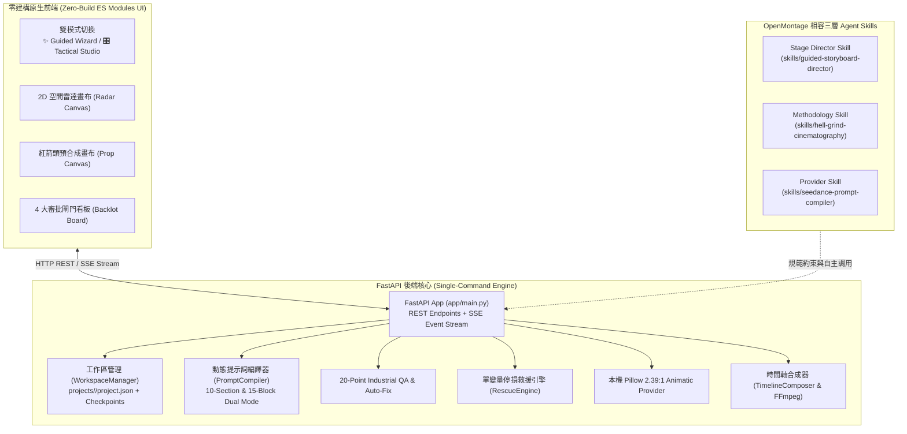

# SSRStudio v2: Guided High-Quality Cinematic AI Video Framework
### 工業級 AI 電影提示詞編譯器 • 雙模式導演引導工作台 • OpenMontage 相容架構
> **Validated by the 2026 Cannes Feature Film *Hell Grind***  
> Supported AI Models: **Seedance 2.0 / 2.5**, **Higgsfield Soul 2.0 / Soul Cinema**, **Nano Banana Pro (NBP)**, **Seedream 4.5**, and **GPT Image 2**.

---

## 📖 系統簡介 (System Overview)

**SSRStudio v2** 是一套結合好萊塢電影視聽語言、坎城獲獎實戰技法與現代 AI 視頻潛在空間特性的**工業級導向式 AI 電影創作框架**。

傳統文字生視頻（Text-to-Video）面臨最致命的六大死線災難：
1. **全景臉漂 (Face Drift)**：遠景模型隨機臆測五官。
2. **空間瞬移 (Character Teleportation)**：鏡頭剪接後角色位置與視線對調。
3. **死板眼神 (Dead Eyes)**：人物凝視虛空缺乏微眼跳與角膜反光。
4. **空氣抓握 (Mimed Manipulation)**：手部與道具在空間中浮動、無實體接觸。
5. **台詞亂動嘴 (Post-Line Filler-Babble)**：台詞結束後下顎持續不自主抽動。
6. **提示詞污染 (Prompt Latent Hallucination)**：隨意更動詞彙導致畫面風格劇烈撕裂。

SSRStudio v2 汲取了 **Higgsfield Hell Grind** 的實戰無頭設定圖法則、**OpenMontage** 的分層 Agent Skills 與審批閘門架構，以及 **MoneyPrinterTurbo** 的輕量極速流水線設計，實現全流程**零打包依賴 (Zero-Build Vanilla ES Modules)**、**單一指令啟動**、**確定論 2.39:1 動態分鏡 Slate 生成**與 **100% 通過 20 點工業 QA** 的自動修復引擎。

---

## 🏛️ 系統架構與關鍵模式 (Architecture & Key Patterns)



### 三大靈感來源與設計模式：
1. **Higgsfield Hell Grind**：
   - **無頭法則 (The Headless Law)**：Panel 1 正面全景抹除頭部，強迫模型向高解析特寫取樣面部，消滅遠景臉漂。
   - **紅箭頭預合成 (`#FF0000`)**：利用精確紅箭頭標籤鎖定手指與道具接觸點，阻斷空氣抓握。
   - **梅斯納生理行為學 (Meisner Acting)**：以客觀生理動作（呼吸、眼跳、肌緊張、抓握急停）取代抽象情緒詞。
2. **OpenMontage**：
   - **三層 Agent Skills 架構**：Stage Director、Methodology、Provider 分層解耦。
   - **4 大 Backlot 審批閘門**：上游資產未簽核前禁止開鏡，每步生成帶時間戳的歷史檢查點。
3. **MoneyPrinterTurbo**：
   - **極簡現代單一指令啟動**：不需要複雜的 Node.js/Webpack 打包，一條指令直開前後端服務。

---

## ⚡ 快速開始 (Quickstart)

本系統採 **Zero-Build Vanilla ES Modules** 架構，前端無須 `npm install` 或任何構建步驟。

### 1. 安裝環境依賴
```powershell
pip install -r requirements.txt
```

### 2. 單一指令啟動服務
```powershell
uvicorn app.main:app --reload --port 8000
```

### 3. 開啟瀏覽器
開啟瀏覽器訪問：
👉 **http://localhost:8000**

系統已內建預熱示範專案 `projects/demo-hell-grind/`，開啟即可立即體驗完整 3 鏡頭分鏡、2D 空間走位、已編譯的 10-Section 提示詞以及 2.39:1 動態分鏡 Slate！

---

## 🎛️ 雙模式工作流 (Dual-Mode Workflow)

SSRStudio v2 專為不同背景的創作者設計了雙向無縫切換的控制介面：

| 功能特性 | ✨ 導演引導模式 (Guided Wizard) | 🎛️ 專家戰術控制台 (Pro Tactical Studio) |
| :--- | :--- | :--- |
| **適用對象** | 零基礎創作者、編劇、獨立製作人 | 專業分鏡師、電影攝影指導、Prompt 工程師 |
| **操作方式** | 點選預設範本或輸入一句話概念，一鍵開案 | 手動微調幾何坐標、光學參數與連續性鎖定 |
| **內建範本** | 鐵籠死鬥 (Hell Grind)、量子金庫 (Cyber Heist)、雪林決鬥 (Snow Bamboo) | 支援自由建立空白專案與多鏡頭無縫切換 |
| **流程導引** | 視覺化 4 大審批閘門卡片與即時狀態回饋 | 深度檢查點恢復、單變量 Diff 比對與停損警報 |
| **提示詞產出** | 自動補全連續性鎖定並一鍵自動修復至 20/20 QA | 支援 10-Section 與 15-Block 雙結構即時手動微調 |

---

## 🚀 核心功能剖析 (Core Features Breakdown)

### 1. 100% 離線確定論 Pillow 2.39:1 Animatic Slate 生成器
- 渲染標準 **2.39:1 CinemaScope (1920×804)** 高保真工業分鏡板。
- 自動繪製：
  - **安全框與三分法構圖輔助線 (Rule of Thirds)**。
  - **中央 2D 空間雷達俯視圖**（主體坐標、視線朝向向量、道具錨點）。
  - **依焦段計算之攝影機視野錐角 (Camera Frustum Cone)**（24mm: 107°、35mm: 84°、50mm: 47°、85mm: 29°、135mm: 18°）。
  - **工業級 Metadata 資訊欄**（Scene/Shot 標籤、SMPTE 時間碼、光學鏡頭鎖、梅斯納刺激與對白）。

### 2. 真實坐標 2D 空間走位雷達 (2D Spatial Radar)
- 互動式 HTML5 Canvas，支援以標準化坐標 $(x, y \in [0.0, 1.0])$ 拖曳攝影機、角色與道具。
- 即時計算角色身軀朝向角度 (Facing Degree) 與 180° 越軸警示。
- 幾何編譯器自動將坐標轉換為 Seedance/Soul 相容之物理空間公尺與方位敘述。

### 3. 紅箭頭接觸預合成工作台 (Red-Arrow Contact Pre-comp)
- 內建專用互動畫布，支援上傳或載入角色與道具底圖。
- 繪製標準電影工業規格之 `#FF0000` 亮紅箭頭與錨定框（Bounding Box）。
- 一鍵匯出為高解析接觸參考圖 (`projects/<id>/assets/`)，徹底消滅空氣抓握。

### 4. 動態 10-Section & 15-Block 提示詞雙模編譯器
- **10-Section 結構 (Seedance 2.0 / 2.5 官方推薦)**：
  - `SECTION 1: GLOBAL STYLE & OPTICAL STACK`
  - `SECTION 2: POSITIVE CAMERA & RENDER CONSTRAINTS`
  - `SECTION 3: CAMERA OPTICS, PERSPECTIVE & RIG MOVE`
  - `SECTION 4: LIGHTING DISCIPLINE & COLOR SCIENCE`
  - `SECTION 5: LOCATION ENVIRONMENT & GEOMETRIC ANCHORS`
  - `SECTION 6: CHARACTER IDENTITY, WARDROBE & CONTINUITY`
  - `SECTION 7: HERO PROPS, TACTILE INTERACTION & RED-ARROW ANCHORS`
  - `SECTION 8: MEISNER OBJECTIVE, BEHAVIOR & MICRO-ACTIONS`
  - `SECTION 9: AUDIO DISCIPLINE, PHONETIC TIMING & DIALOGUE`
  - `SECTION 10: ANTI-DRIFT NEGATIVE LOCKS`
- **五大具名連續性鎖定 (5 Named Continuity Locks)**：
  - `First Frame Lock`（首秒定裝與幾何錨定）
  - `Screen Direction Lock`（180° 越軸保護線）
  - `Lens Lock`（嚴格鎖定無焦距滑移）
  - `Count Lock`（畫內精確人數約束）
  - `Stillness Lock`（背景幾何剛性鎖定）
  - `Monotonic State Notes`（單調狀態演進：塵埃、雨水、傷痕只增不減）

### 5. 20 點工業級 QA 審查與一鍵自動修復 (20-Point Industrial QA & Auto-Fix)
- 針對焦段規格、模糊空間詞、抽象情緒形容詞、梅斯納生理三句律、角膜反光、抓握停頓、閉嘴鎖進行逐項嚴格掃描。
- 提供 `POST /api/projects/{id}/shots/{id}/auto-fix`，0.1 秒內自動糾正不合格屬性，保證達到 **20/20 滿分通過**。

### 6. 單變量停損救援引擎 (Single-Variable Diff & Rescue Engine)
- **Token 級變更審計**：監控提示詞更動幅度，若單次修改超過一個實體或光學維度立即發出警報。
- **10–15 次迭代停損警報**：
  - 第 10 次微調無果觸發黃色警戒。
  - 第 15 次觸發紅色停損（「停止改詞！已超出模型潛在空間」）。
- **坎城級降維救援方案**：
  - 一鍵切換為「0.8 秒反應特寫橋接鏡 (0.8s Reaction Bridge Cut)」。
  - 拆分為雙機位兩鏡。
  - 移除次要道具以換取手部穩定度。

### 7. 四大 Backlot 審批閘門與檢查點系統 (Backlot Approval Gates)
- **Gate 1: Story Funnel**（五階段故事漏斗審批）
- **Gate 2: Asset Bible**（無頭三視圖與資產鎖定）
- **Gate 3: Storyboard & Blocking**（2D 雷達走位與紅箭頭預合成）
- **Gate 4: Final Render & Assembly**（10-Section 編譯、20 點 QA 與時間軸合成）
- 每次審批狀態變更時，後端自動於 `checkpoints/` 生成帶時間戳的完整專案快照。

---

## 🤖 專案內建 Agent Skills 目錄 (Agent Skills Catalog)

SSRStudio v2 原生整合了 OpenMontage 相容的三層 Agent Skills 架構，位於 `skills/` 目錄：

```
skills/
├── guided-storyboard-director/   # [Layer 2] 階段導演技能 (Stage Director)
│   └── SKILL.md                 # 引導 4 大審批閘門推進、REST API 調用與工作區存檔
├── hell-grind-cinematography/    # [Layer 1] 電影方法論技能 (Methodology)
│   └── SKILL.md                 # 坎城無頭圖、紅箭頭預合成、梅斯納動詞、單變量停損守則
└── seedance-prompt-compiler/     # [Layer 3] 模型編譯器技能 (Provider Compiler)
    └── SKILL.md                 # Seedance 2.0 / 2.5 雙模編譯、5 大連續性鎖與音色錨點
```

在 Antigravity 或任何 Coding Agent 中工作時，Agent 可直接讀取這些技能標準，自主完成專業級分鏡創作。

---

## 🔌 可插拔 Provider 適配器擴充指南 (Pluggable Providers)

SSRStudio v2 採用乾淨的抽象協定（Protocols / Abstract Base Classes），便於將本地模擬環境無縫切換為線上生成服務：

```python
# app/core/tool_registry.py 或 app/services/media_providers.py
from app.core.tool_registry import BaseImageProvider, BaseVideoProvider, BaseTTSProvider
from app.services.llm_director import BaseLLMProvider

# 1. 擴充文字大模型 (LLM Provider)
class CustomOpenAILLM(BaseLLMProvider):
    def complete(self, prompt: str, **kwargs) -> str:
        # 串接 OpenAI / Gemini / Claude API
        return "..."

# 2. 擴充文生圖模型 (Image Provider)
class Soul2LiveImageAdapter(BaseImageProvider):
    def generate_image(self, prompt: str, **kwargs) -> str:
        # 呼叫 Higgsfield Soul 2.0 官方 API 生成無頭設定圖
        return "https://..."

# 3. 擴充生視頻模型 (Video Provider)
class SeedanceLiveVideoAdapter(BaseVideoProvider):
    def generate_video(self, prompt: str, **kwargs) -> str:
        # 呼叫 ByteDance Seedance 2.0 API 提交 10-Section Prompt
        return "https://..."
```

---

## 📁 專案檔案結構 (Project Layout)

```
ssrstudio/
├── app/                        # 後端核心服務
│   ├── api/                    # FastAPI REST & SSE 路由 (projects, compiler, assets, wizard, events)
│   ├── core/                   # 幾何編譯器、提示詞編譯器、Linter、QA、救援引擎、工作區管理
│   ├── models/                 # Pydantic 資料模型 (ProjectState, ShotSpec, StoryFunnel 等)
│   ├── services/               # 引導導演服務 (LLMDirector)、媒體適配器、時間軸合成器
│   ├── config.py               # 路徑與常數配置
│   └── main.py                 # FastAPI 入口 (一鍵掛載靜態資源與 API)
├── web/                        # 前端原生 ES Modules (Zero-Build)
│   ├── css/studio.css          # 工業級電影工作台深色樣式
│   └── js/                     # 原生 ES 模組 (app.js, api_client.js, guided_wizard.js, radar_canvas.js, etc.)
├── skills/                     # 三層 OpenMontage 相容 Agent Skills
├── projects/                   # 工作區專案目錄
│   └── demo-hell-grind/        # 內建預熱示範專案 (含 project.json, checkpoints, renders)
├── tests/                      # 全套自動化測試 (100% 通過)
├── index.html                  # 前端主頁面入口
└── pytest.ini                  # Pytest 配置
```

---

## 🧪 測試與驗證 (Verification)

執行全套測試套件：
```powershell
pytest -v
```
預期結果：**22 passed, 100% pass rate**。

---

## 📄 授權條款 (License)

SSRStudio v2 遵循 MIT 授權條款。歡迎自由使用、修改與二次開發！
