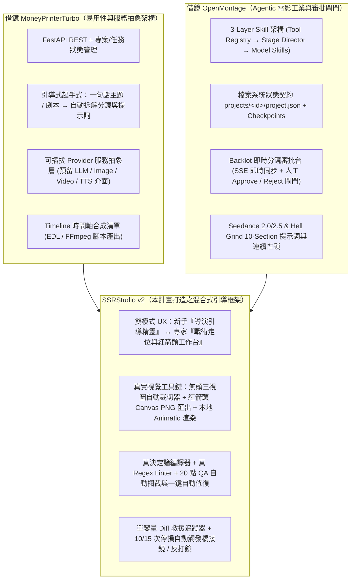
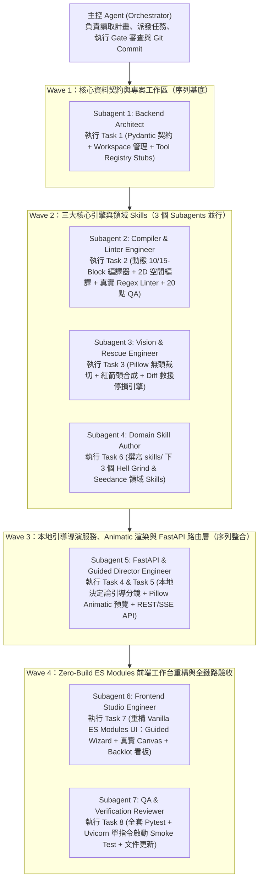

# SSRStudio v2：引導式高品質 AI 電影級影片製作框架 — 架構評估與 Coding Agent 執行計畫

> **For agentic workers:** REQUIRED SUB-SKILL: Use `superpowers:subagent-driven-development` (recommended) or `superpowers:executing-plans` to implement this plan task-by-task. Steps use checkbox (`- [ ]`) syntax for tracking.

---

## 📌 架構決策鎖定（Architecture Decisions Locked — 2026-10-16）

1. **外部生成 API 策略（Provider Stub & Local Animatic First）**：
   - **暫不實作真實外部付費 API 調用**（待後續決定具體 Provider 與金鑰方案後再行擴充）。
   - 現階段採用 **Clean Provider Adapter Interface（統一抽象介面 + 本地決定論引擎 + Pillow 技術分鏡動態預覽圖生成器 Technical Animatic Slate Generator）**：
     - `app/core/tool_registry.py` 與 `app/services/media_providers.py` 定義標準化 `BaseLLMProvider`、`BaseImageProvider`、`BaseVideoProvider`、`BaseTTSProvider` 抽象協定（Protocol / ABC）。
     - 預設啟用 **`LocalDeterministicDirector`（規則與模板驅動之智慧引導導演）** 與 **`LocalAnimaticProvider`（使用 Pillow 即時繪製 2.39:1 變形寬銀幕分鏡構圖、焦段標尺、角色走位向量、紅箭頭接觸預合成圖與時間碼 Slate PNG）**，達成 **100% 離線零 API Key 即可跑通完整引導、編譯、20 點 QA、無頭裁切、紅箭頭合成、單變量救援與時間軸預覽全流程**。
2. **前端技術棧（Zero-Build Vanilla ES Modules）**：
   - 採用 **零編譯打包依賴的 Vanilla ES Modules（`web/js/*.js` + `web/css/studio.css`）**，由 FastAPI 直接掛載靜態目錄與根路由。
   - **單一啟動指令**：開發與執行皆僅需一行 `uvicorn app.main:app --reload --port 8000` 即可同時運行前後端與 SSE 即時同步服務（完全不需 Node.js / Vite / Webpack 打包步驟）。

---

**Goal:** 將目前僅為單頁靜態假資料原型（Static Mock）的 `ssrstudio`（[index.html](file:///c:/Users/p0282768/Downloads/ssrstudio/index.html)），重構為結合 **Higgsfield `hell-grind` 工業級電影方法論**、**OpenMontage 三層 Agentic Skill + Backlot 審批閘門架構** 與 **MoneyPrinterTurbo 模組化 FastAPI 任務狀態引擎** 的「引導式高品質 AI 影片製作框架（SSRStudio v2）」。

**Architecture:**
採用 **Hybrid Guided & Agentic Architecture（雙軌引導與代理協作架構）**：
1. **後端核心（借鏡 MoneyPrinterTurbo + OpenMontage）**：以 Python `FastAPI` 建構 REST + SSE 即時狀態串流服務，搭配檔案系統為基礎的 `projects/<project-id>/` 專案狀態契約（`project.json`、`checkpoints/`、`assets/`、`shots/`、`renders/`），讓 WebUI 與 Coding Agent 共享同一份 Single Source of Truth。
2. **三層知識與編譯引擎（借鏡 OpenMontage + Hell Grind）**：
   - **Layer 1 (`app/core/tool_registry.py`)**：統一宣告 LLM、圖片生成（Nano Banana Pro / Soul 2.0 / Seedream 4.5 / Flux）、影片生成（Seedance 2.0 / 2.5 / Kling / Veo）、語音（TTS）與合成（FFmpeg）之**可插拔介面規格（Pluggable Adapter Specs）**，預設綁定本地決定論引擎與 Animatic 渲染器。
   - **Layer 2 (`skills/guided-storyboard-director/`)**：階段導演引導技能（Story Funnel → Asset Bible → Visual Blocking → Shot Prompt Compilation → Surgical Rescue → Timeline Assembly）。
   - **Layer 3 (`skills/hell-grind-cinematography/` & `skills/seedance-prompt-compiler/`)**：封裝 Higgsfield *Hell Grind* 的 **10-Section / 15-Block 決定論編譯器**、**Named Continuity Locks（連續性鎖）**、**真正在 Canvas 匯出 PNG 參考圖的無頭三視圖（Headless 3-Panel Sheet）與紅箭頭道具接觸圖（Red-Arrow Contact Sheet）**、以及 **10–15 次單變量迭代停損規則（Stop-Loss Rescue）**。
3. **前端互動工作台（Zero-Build Vanilla ES Modules：Guided Studio + Living Backlot UI）**：將原本 2,848 行耦合的 [index.html](file:///c:/Users/p0282768/Downloads/ssrstudio/index.html) 拆解為原生 ES Modules（`web/js/*.js` + `web/css/studio.css`），由 FastAPI 直接服務，支援 **「AI 導演引導模式（1-Click 劇本拆解分鏡）」** 與 **「專家戰術控制台（2D Radar 走位、紅箭頭畫布、Diff 救援日誌、即時分鏡審批閘門）」** 自由切換。

**Tech Stack:**
- **Backend:** Python 3.11+, FastAPI, Pydantic v2, Uvicorn, SSE (`sse-starlette` 或原生 `StreamingResponse`), Pillow (無頭裁切 / 紅箭頭合成 / 本地 2.39:1 Animatic 分鏡板渲染)
- **Frontend:** 原生 HTML5 + Vanilla ES Modules (`type="module"`) + CSS Variables (`web/css/studio.css`)，零 Node 打包依賴，由 `uvicorn app.main:app` 直接掛載服務
- **Agentic / Skills:** `skills/` (OpenMontage 相容三層 Skill 架構) + Antigravity Superpowers Subagent 調度工作流
- **Testing:** `pytest`, `httpx` (`TestClient` API 與全流程整合測試)

---

## 第一部分：Higgsfield `hell-grind` 實況提取與現有 `ssrstudio` 框架深度評估

### 1.1 Higgsfield `hell-grind` 專案真實結構解析（API 實測數據）

透過解析 `https://higgsfield.ai/@higgsfield.studio/projects/hell-grind` 前端路由與後端 Gateway (`https://fnf-api-gw.higgsfield.ai/fnf/publications/hell-grind`)，我們提取出該教學與專案的真實生產結構（詳見暫存檔 [hf_api_dump.json](file:///C:/Users/p0282768/.gemini/antigravity/brain/735a11eb-04a9-4f6a-99cf-08e4b7e2a296/scratch/hf_api_dump.json)）：
- **規模與規格**：全片長 **96 分鐘（5759.85 秒）**、超寬銀幕 `4096×1716` (2.39:1 Anamorphic)，由 **35 位協作者** 共同完成，專案快照（Snapshot Folder `3caa2f3a-52b5-4293-9237-0c8f76c7158a`）共包含 **109 個子資料夾**、總計 **115,446 個生成任務（Jobs）**。
- **真實資產與工作流契約**：
  1. 每個生成任務（Job Set）皆記錄完整的 **`job_set_type`**（如 `nano_banana_2`、`soul_2`、`seedance`）、**`input_images` 鎖定錨點陣列**（將上游核准的角色三視圖、臉部特寫、環境空鏡、道具圖作為下游圖片/影片生成的強綁定輸入），以及明確的 **`params.prompt`** 與解析度設定。
  2. 結合 OpenMontage 已提煉的 Higgsfield 2026 實戰規範（參見 [seedance_2_5.md](file:///C:/Users/p0282768/.gemini/antigravity/brain/735a11eb-04a9-4f6a-99cf-08e4b7e2a296/scratch/seedance_2_5.md) 與 [seedance_2_5_techniques.md](file:///C:/Users/p0282768/.gemini/antigravity/brain/735a11eb-04a9-4f6a-99cf-08e4b7e2a296/scratch/seedance_2_5_techniques.md)），其核心成功關鍵在於：
     - **10-Section / 15-Block 結構化提示詞契約**：`GLOBAL STYLE` → `SCENE` → `CHARACTERS` → `LOCATION` → `FIRST FRAME AND BLOCKING` → `Shot 1..N Hard cut` → `OPTICS / CAMERA` → `PHYSICS` → `LIGHTING` → `AUDIO`。
     - **五大具名連續性鎖（Named Continuity Locks）**：`FIRST FRAME AND SPATIAL BLOCKING`、`SCREEN DIRECTION`、`LENS LOCK`、`COUNT LOCK`、`STILLNESS LOCK`。
     - **State Monotonicity（狀態單調性）**：灰塵、汗水、傷口、破損在單一鏡頭或跨鏡頭只能累加，不可憑空消失。
     - **物理預合成（Pre-Compositing）**：Seedance 等視訊模型不擅長即時「憑空拾取與複雜交握」，必須先在圖像階段將道具與手部預合成（搭配紅箭頭 `#FF0000` 標註），再作為 First Frame 送入視訊模型。

---

### 1.2 現有 `ssrstudio` 框架為何「目前不可用」？（程式碼級診斷）

審計現有倉庫的 [README.md](file:///c:/Users/p0282768/Downloads/ssrstudio/README.md) 與 2,848 行的單體檔案 [index.html](file:///c:/Users/p0282768/Downloads/ssrstudio/index.html) 後，結論非常明確：**目前的 `ssrstudio` 只是一個寫死假資料的「概念展示網頁（Static UI Mockup）」，完全不具備實際生產影片的能力。**

| 診斷維度 | 現有 `index.html` 實作真相（含行號） | 為何導致不可用？ |
| :--- | :--- | :--- |
| **1. 15-Block 編譯器有 73% 是寫死的假字串** | 在 [`compile15BlockPrompt()`](file:///c:/Users/p0282768/Downloads/ssrstudio/index.html#L2502-L2555) 中，Block `[01/15]` 到 `[11/15]` 以及 `[15/15]` **完全寫死**為 `@roco`、`@master_kane` 與 `@underground_gym` 的格鬥訓練場描述！使用者在 Stage 1～3 輸入任何劇本或題材，編譯出來的提示詞永遠是 Roco 與 Master Kane。 | 使用者無法用它製作自己的故事或角色，只能看預設 Demo。 |
| **2. 2D 空間雷達編譯與 Linter 完全造假** | [`compileGeoPrompt()`](file:///c:/Users/p0282768/Downloads/ssrstudio/index.html#L2410-L2420) 根本沒有讀取 Canvas 上節點 (`state.stage3.nodes`) 的實際 $(x, y)$ 座標與攝影機角度，直接回傳固定字串；[`sanitizeGeoPrompt()`](file:///c:/Users/p0282768/Downloads/ssrstudio/index.html#L2422-L2424) 完全沒做 Regex 檢查，只彈出 `"0 weak spatial words detected"` 假通知。 | 視覺化拖曳走位與文字輸出完全脫節（假互動）。 |
| **3. 20 點 QA 檢查表 100% 寫死通過** | [`runAuditChecklist()`](file:///c:/Users/p0282768/Downloads/ssrstudio/index.html#L2577-L2603) 內部的 `checks` 陣列將全部 20 個項目硬編碼為 `pass: true`，完全沒有檢查實際輸入內容。 | 喪失「工業級防呆閘門（Gatekeeper）」的核心價值。 |
| **4. 道具紅箭頭畫布無法上傳圖片也無法匯出** | [`drawPropScene()`](file:///c:/Users/p0282768/Downloads/ssrstudio/index.html#L2300-L2345) 只是用 Canvas 2D API 畫了一把寫死的多邊形匕首；既不能載入真實角色/道具圖片，也沒有 `canvas.toBlob()` 匯出為模型可用的 `input_images` 參考圖。 | 無法產出餵給下游模型的真實預合成圖檔。 |
| **5. 僅能保存「單一鏡頭」表單，無多鏡分鏡表** | [`AppState`](file:///c:/Users/p0282768/Downloads/ssrstudio/index.html#L1940-L2020) 僅在 `localStorage` 存單一鏡頭的欄位，沒有 `Project -> Episode -> Scene -> Shot` 的階層結構，無法管理一部由多顆鏡頭組成的短片。 | 只能當單一 Prompt 玩具，無法製作完整影片。 |
| **6. 零後端、零引導生成、認知負荷極高** | 專案只有 `index.html` 與 `README.md`，要求使用者手動填寫數十個專業欄位，缺乏自動拆解分鏡的引導精靈。 | **認知負荷極高、產出效率為零**，不符合「友善的引導式高品質影片製作框架」。 |

---

### 1.3 借鏡成熟專案：`OpenMontage` vs. `MoneyPrinterTurbo` 優勢整合矩陣



---

## 第二部分：SSRStudio v2 目標系統架構與目錄結構

### 2.1 專案目錄結構設計（File Map）

重構後的倉庫採用 **單一 `uvicorn app.main:app` 啟動架構**，由 FastAPI 直接提供 API 與 Zero-Build Vanilla ES Modules 前端服務：

```text
ssrstudio/
├── app/                                  # [借鏡 MoneyPrinterTurbo] FastAPI 後端與核心引擎
│   ├── __init__.py
│   ├── main.py                           # FastAPI 入口、掛載 /web 靜態 ES Modules 與根路由 index.html
│   ├── config.py                         # 專案路徑設定與可插拔 Provider 預設組態
│   ├── models/
│   │   ├── __init__.py
│   │   ├── project.py                    # Project, Scene, Shot, Asset, Checkpoint Pydantic Schemas
│   │   └── compiler.py                   # 10-Section / 15-Block 編譯輸入輸出與 QA Audit Schemas
│   ├── core/
│   │   ├── __init__.py
│   │   ├── tool_registry.py              # [借鏡 OpenMontage Layer 1] 工具與 Provider 介面註冊表 (Stubs + Local Engines)
│   │   ├── workspace.py                  # projects/<id>/ 檔案讀寫、Checkpoint 與事件日誌管理
│   │   ├── prompt_compiler.py            # 真實動態 10-Section & 15-Block 雙模提示詞編譯器
│   │   ├── spatial_compiler.py           # 2D 雷達座標 (x, y, angle, lens) → 嚴格空間語句轉換器
│   │   ├── prompt_linter.py              # 真實禁用詞 Regex 掃描、自動替換與 20 點 QA 驗證器
│   │   ├── image_ops.py                  # Pillow 無頭三視圖裁切 (Headless Crop) 與紅箭頭預合成圖處理
│   │   └── rescue_engine.py              # 單變量 Diff 計算、迭代計數器與 10/15 次停損救援建議器
│   ├── services/
│   │   ├── __init__.py
│   │   ├── llm_director.py               # 智慧引導導演引擎：本地決定論展開 5-Stage Funnel、角色表與分鏡 (預留 LLM 接口)
│   │   ├── media_providers.py            # 本地 Pillow 2.39:1 技術分鏡板 (Animatic Slate) 生成器 + 外部 Provider Stubs
│   │   └── timeline_composer.py          # J/L-cut 時間軸組裝清單 (Timeline Manifest) 與 FFmpeg 命令生成器
│   └── api/
│       ├── __init__.py
│       ├── routes_projects.py            # 專案 CRUD、分鏡審批閘門 (Approve/Reject)、Checkpoints
│       ├── routes_compiler.py            # 提示詞編譯、Linter、20點 QA、空間雷達與 Diff 救援 API
│       ├── routes_assets.py              # 圖片上傳、無頭裁切、紅箭頭 Canvas PNG 保存 API
│       ├── routes_wizard.py              # 引導式生成 API (一鍵從創意展開分鏡、預設參數與自動修復 QA)
│       └── routes_events.py              # [借鏡 OpenMontage Backlot] SSE 即時狀態推送 (/api/events)
├── web/                                  # Zero-Build Vanilla ES Modules 前端工作台 (由 FastAPI 直接掛載)
│   ├── css/
│   │   └── studio.css                    # 工業級暗黑主題樣式 + Guided Wizard 與 Backlot 看板樣式
│   └── js/
│       ├── app.js                        # ES Module 主入口：狀態管理、SSE 監聽、專案/鏡頭切換、雙模切換
│       ├── api_client.js                 # 對接 FastAPI 後端的 REST 封裝
│       ├── guided_wizard.js              # [新增] 友善的引導式導演精靈 (Step-by-step 帶飛新手)
│       ├── radar_canvas.js               # 真實讀取座標並即時調用空間編譯器的 2D 走位雷達
│       ├── prop_canvas.js                # 支援底圖載入、紅箭頭繪製與 PNG DataURL 匯出上傳的預合成畫布
│       └── backlot_board.js              # [借鏡 OpenMontage] 多鏡頭分鏡審批看板與時間軸預覽
├── index.html                            # 主網頁入口 (由 FastAPI 根路由 `/` 服務，透過 `<script type="module" src="/web/js/app.js">` 載入)
├── skills/                               # [借鏡 OpenMontage Layer 2 & 3] 專案內建可調用 Agent Skills
│   ├── guided-storyboard-director/
│   │   └── SKILL.md                      # 階段導演 Skill：引導使用者從一句話完成分鏡與資產鎖定
│   ├── hell-grind-cinematography/
│   │   └── SKILL.md                      # Hell Grind 工業規範：無頭三視圖、紅箭頭、狀態單調性、停損救援
│   └── seedance-prompt-compiler/
│       └── SKILL.md                      # Seedance 2.0 / 2.5 10-Section 與 15-Block 編譯規範與連續性鎖
├── projects/                             # 執行期專案資產目錄 (Single Source of Truth)
│   └── demo-hell-grind/                  # 預設示範專案 (含真實 JSON 結構、檢查點與 Animatic 預覽圖)
├── tests/                                # 完整單元測試與 API 整合測試
│   ├── test_workspace_and_models.py
│   ├── test_compiler_and_linter.py
│   ├── test_image_ops_and_rescue.py
│   ├── test_guided_director_service.py
│   └── test_api_workflow.py
├── requirements.txt
└── README.md
```

---

## 第三部分：Skills 映射與 Subagent 協作調度規劃（Orchestration Plan）

### 3.1 當前可用 Skills 映射表（Global Skills + Project Skills）

#### A. 開發流程與架構管控類（Superpowers & Orchestration Skills）
| Skill 名稱 | 絕對路徑 | 在本計畫中的調用階段與職責 |
| :--- | :--- | :--- |
| **`using-superpowers`** | [SKILL.md](file:///C:/Users/p0282768/.gemini/config/plugins/superpowers/skills/using-superpowers/SKILL.md) | 每個 Session 啟動時載入，確保嚴格遵守 Skill 優先與驗證紀律。 |
| **`subagent-driven-development`** | [SKILL.md](file:///C:/Users/p0282768/.gemini/config/plugins/superpowers/skills/subagent-driven-development/SKILL.md) | **主控執行模式**：由主 Agent 擔任 Controller，按 Task 1～Task 8 派發獨立 Subagent，並在每個 Task 後執行 Spec Compliance 與 Code Quality 審查。 |
| **`dispatching-parallel-agents`** | [SKILL.md](file:///C:/Users/p0282768/.gemini/config/plugins/superpowers/skills/dispatching-parallel-agents/SKILL.md) | 當多個模組無共享寫入衝突時（例如 Wave 2 的 Task 2 空間/Linter 引擎、Task 3 圖像/救援引擎、Task 6 專案內建 Skills 撰寫），並行喚醒多個 Subagents 加速開發。 |
| **`test-driven-development`** | [SKILL.md](file:///C:/Users/p0282768/.gemini/config/plugins/superpowers/skills/test-driven-development/SKILL.md) | 每個實作 Subagent 必須遵循 `RED -> GREEN -> REFACTOR`：先寫 `pytest` 測試確認失敗，再寫最少實作碼使其通過。 |
| **`verification-before-completion`** | [SKILL.md](file:///C:/Users/p0282768/.gemini/config/plugins/superpowers/skills/verification-before-completion/SKILL.md) | 宣告任何 Task 或整體計畫完成前，必須實際執行 `pytest` 與 API 端點測試，確認 Exit Code 0。 |
| **`mingit`** | [SKILL.md](file:///C:/Users/p0282768/.gemini/config/skills/mingit/SKILL.md) | Windows 環境下所有 Git 操作一律使用 `C:\Users\p0282768\.gemini\antigravity\scratch\mingit\cmd\git.exe`（且禁止使用 `cd` 指令，改用 `Cwd` 參數或 `git -C`）。 |
| **`speak-human-tw`** | [SKILL.md](file:///C:/Users/p0282768/.gemini/config/skills/speak-human-tw/SKILL.md) | 撰寫前端繁體中文引導文案（Guided Wizard 提示語、錯誤診斷建議）與 `README.md` 時，確保自然流暢、無生硬機器翻譯腔。 |

#### B. 專案內建領域類（將在 Task 6 建立於 `ssrstudio/skills/` 下）
1. **`skills/guided-storyboard-director/SKILL.md`**：定義如何以「友善問答 / 一鍵展開」協助非專業使用者從一句話構想產出 5 階段故事漏斗、角色設定與分鏡表。
2. **`skills/hell-grind-cinematography/SKILL.md`**：封裝 Higgsfield *Hell Grind* 的資產防禦規範（無頭三視圖裁切、紅箭頭接觸預合成、狀態單調性、10/15 次停損救援）。
3. **`skills/seedance-prompt-compiler/SKILL.md`**：封裝 Seedance 2.0 / 2.5 的 10-Section 與 15-Block 編譯規則、五大具名連續性鎖（Continuity Locks）與 Meisner 生理動詞映射表。

---

### 3.2 Subagent 調度拓撲圖（Subagent Dispatch Topology）

主 Agent（Orchestrator）透過 `invoke_subagent` 工具（預設使用 `TypeName="self"` 與 `Model="inherit"`）按以下四個波次（Waves）執行：



---

## 第四部分：Coding Agent 可執行實作計畫（Tasks 1 – 8）

---

### Task 1：建立專案結構、Pydantic 核心資料契約與檔案系統工作區（Workspace & Pluggable Tool Registry）

**Files:**
- Create: `requirements.txt`
- Create: `app/__init__.py`
- Create: `app/config.py`
- Create: `app/models/__init__.py`
- Create: `app/models/project.py`
- Create: `app/models/compiler.py`
- Create: `app/core/__init__.py`
- Create: `app/core/tool_registry.py`
- Create: `app/core/workspace.py`
- Test: `tests/test_workspace_and_models.py`

- [ ] **Step 1: 撰寫 `tests/test_workspace_and_models.py` 驗證專案多鏡頭狀態、審批閘門與可插拔 Tool Registry（RED）**

```python
import pytest
from pathlib import Path
from app.models.project import (
    ProjectState, StoryFunnel, ShotSpec, SpatialNode, ApprovalGateStatus
)
from app.core.workspace import WorkspaceManager
from app.core.tool_registry import ToolRegistry

def test_create_and_load_project(tmp_path: Path):
    ws = WorkspaceManager(base_dir=tmp_path)
    proj = ws.create_project(
        title="Hell Grind Demo",
        idea="一名拳擊手在地下鐵籠面對機械改造宗師的最後一戰"
    )
    assert proj.project_id.startswith("proj-")
    assert (tmp_path / proj.project_id / "project.json").exists()
    assert len(proj.shots) >= 1

    # 測試更新 Gate 狀態並儲存 Checkpoint
    loaded = ws.update_gate(proj.project_id, "story_funnel", ApprovalGateStatus.APPROVED)
    assert loaded.gates["story_funnel"] == ApprovalGateStatus.APPROVED
    checkpoints = list((tmp_path / proj.project_id / "checkpoints").glob("*.json"))
    assert len(checkpoints) >= 1

def test_tool_registry_pluggable_specs():
    registry = ToolRegistry()
    video_tools = registry.list_tools(category="video_generation")
    assert any(t["id"] == "seedance_2_5" for t in video_tools)
    assert any(t["id"] == "local_animatic_slate" and t["mode"] == "local_active" for t in video_tools)
    image_tools = registry.list_tools(category="image_generation")
    assert any(t["id"] == "nano_banana_pro" for t in image_tools)
```

- [ ] **Step 2: 執行 `pytest` 確認測試因模組尚未建立而失敗**

Run: `pytest tests/test_workspace_and_models.py -v`
Expected: FAIL (`ModuleNotFoundError: No module named 'app'`)

- [ ] **Step 3: 建立 `requirements.txt`、`app/config.py`、`app/models/project.py`、`app/models/compiler.py`、`app/core/tool_registry.py` 與 `app/core/workspace.py`（GREEN）**

關鍵契約要求：
1. `requirements.txt` 保持極簡輕量（無外部付費 SDK 強依賴）：
   ```text
   fastapi>=0.110.0
   uvicorn[standard]>=0.29.0
   pydantic>=2.7.0
   Pillow>=10.3.0
   python-multipart>=0.0.9
   httpx>=0.27.0
   pytest>=8.1.0
   ```
2. `app/models/project.py` 定義：
   - `StoryFunnel`：`genre_tone`, `world_reality`, `core_conflict`, `protagonist_arc`, `visual_motif`, `aspect_ratio` (預設 `"2.39:1"`), `target_duration_sec`
   - `CharacterAsset`：`handle` (如 `"@roco"`), `name`, `wardrobe_lock`, `voice_lock` (逐字發音錨點字串), `turnaround_image`, `headless_sheet_image`, `closeup_images`
   - `LocationAsset`：`handle` (如 `"@underground_gym"`), `name`, `lighting_lock`, `architecture_lock`, `reference_images`
   - `PropAsset`：`handle`, `name`, `material_lock`, `contact_sheet_image`
   - `SpatialNode`：`id`, `handle`, `role` (`"subject"` | `"camera"` | `"light"` | `"prop"`), `x` (0.0–1.0), `y` (0.0–1.0), `facing_deg` (0–360)
   - `ContinuityLocks`：`first_frame_lock`, `screen_direction_lock`, `lens_lock`, `count_lock`, `stillness_lock`, `monotonic_state_notes`
   - `ShotSpec`：`shot_id`, `scene_id`, `order`, `title`, `duration_sec` (5 / 10 / 15), `camera_lens_mm` (24 / 35 / 50 / 85 / 135), `camera_move`, `spatial_nodes`, `meisner_stimulus`, `meisner_micro_action`, `dialogue_line`, `continuity_locks`, `precomp_image_path`, `animatic_Drop_path`, `compiled_10_section`, `compiled_15_block`, `qa_passed`, `iteration_count`, `rescue_history`, `status`
   - `ProjectState`：包含 `project_id`, `title`, `idea`, `funnel`, `characters`, `locations`, `props`, `shots`, `gates` (`story_funnel`, `asset_bible`, `storyboard_blocking`, `final_render`)。
3. `app/core/tool_registry.py` 宣告支援的模型規格與狀態（預設啟用 `local_deterministic_director` 與 `local_animatic_slate`，而將 `nano_banana_pro`, `soul_2_0`, `seedream_4_5`, `seedance_2_5`, `seedance_2_0`, `elevenlabs_tts` 標記為 `adapter_stub_ready`，預留 `register_adapter()` 供未來隨時掛載真實 API）。

- [ ] **Step 4: 重新執行 `pytest` 驗證通過**

Run: `pytest tests/test_workspace_and_models.py -v`
Expected: PASS

- [ ] **Step 5: 使用 MinGit 提交 Task 1**

Run: `C:\Users\p0282768\.gemini\antigravity\scratch\mingit\cmd\git.exe add requirements.txt app/ tests/test_workspace_and_models.py`
Run: `C:\Users\p0282768\.gemini\antigravity\scratch\mingit\cmd\git.exe commit -m "feat(core): add project schemas, workspace manager, and pluggable tool registry"`

---

### Task 2：實作真實動態提示詞編譯器（10-Section & 15-Block）、2D 空間雷達編譯器與 20 點 QA Linter

**Files:**
- Create: `app/core/spatial_compiler.py`
- Create: `app/core/prompt_linter.py`
- Create: `app/core/prompt_compiler.py`
- Test: `tests/test_compiler_and_linter.py`

> **關鍵修復目標**：徹底消滅原 `index.html` 中寫死 `@roco` 與 `@master_kane`、假座標轉換、以及假 20 點 QA 的問題。

- [ ] **Step 1: 撰寫 `tests/test_compiler_and_linter.py`（RED）**

```python
from app.models.project import (
    ProjectState, StoryFunnel, CharacterAsset, LocationAsset, ShotSpec, SpatialNode, ContinuityLocks
)
from app.core.spatial_compiler import compile_spatial_blocking
from app.core.prompt_linter import lint_and_sanitize_prompt, evaluate_20_point_qa
from app.core.prompt_compiler import compile_shot_prompts

def test_spatial_compiler_uses_real_coordinates():
    nodes = [
        SpatialNode(id="n1", handle="@elena", role="subject", x=0.22, y=0.72, facing_deg=0),
        SpatialNode(id="n2", handle="@drone_boss", role="subject", x=0.78, y=0.25, facing_deg=180),
        SpatialNode(id="cam", handle="@cam_a", role="camera", x=0.50, y=0.90, facing_deg=270),
    ]
    text = compile_spatial_blocking(nodes, lens_mm=85, camera_move="Locked-off tripod")
    assert "@elena" in text
    assert "@drone_boss" in text
    assert "@roco" not in text  # 絕不可出現寫死的舊角色
    assert "screen-left" in text.lower()
    assert "foreground" in text.lower()
    assert "screen-right" in text.lower()
    assert "background" in text.lower()
    assert "85mm" in text

def test_linter_catches_weak_words_and_emotions():
    raw = "Camera stands near the door, next to @elena who feels sad and angry."
    res = lint_and_sanitize_prompt(raw)
    assert res.detected_count >= 3
    assert "near" not in res.sanitized_text.lower()
    assert "sad" not in res.sanitized_text.lower()

def test_dynamic_15_block_and_10_section_compiler():
    proj = ProjectState(
        project_id="proj-test",
        title="Cyber Heist",
        idea="駭客潛入量子金庫",
        funnel=StoryFunnel(
            genre_tone="Neo-Noir Cyberpunk Thriller",
            world_reality="Rain-slicked Tokyo mega-vault in 2089",
            core_conflict="@elena must bypass the laser grid before @warden arrives",
            protagonist_arc="From panicked rookie to cold tactician",
            visual_motif="High-contrast cyan laser beams cutting through wet concrete",
            aspect_ratio="2.39:1"
        ),
        characters=[
            CharacterAsset(
                handle="@elena",
                name="Elena Vance",
                wardrobe_lock="matte black tactical raincoat with silver circuit seams",
                voice_lock="Measured alto voice, crisp consonant articulation, slight vocal fry"
            )
        ],
        locations=[
            LocationAsset(
                handle="@quantum_vault",
                name="Sub-level 9 Quantum Vault",
                lighting_lock="Overhead cold 5600K strip lights + sweeping red laser grid",
                architecture_lock="Brutalist obsidian pillars and wet grated steel floor"
            )
        ],
        shots=[
            ShotSpec(
                shot_id="shot-01",
                scene_id="sc-01",
                order=1,
                title="Vault Entry",
                duration_sec=10,
                camera_lens_mm=35,
                camera_move="Slow dolly-in along floor grate",
                spatial_nodes=[
                    SpatialNode(id="s1", handle="@elena", role="subject", x=0.3, y=0.6, facing_deg=45)
                ],
                meisner_stimulus="Red laser beam slices 2cm past her left cheek",
                meisner_micro_action="Pupils dilate, jaw clenches, right thumb clicks the brass decryptor switch twice",
                dialogue_line="We have twelve seconds.",
                continuity_locks=ContinuityLocks(
                    first_frame_lock="@elena crouched at screen-left behind obsidian pillar",
                    screen_direction_lock="@elena faces screen-right throughout",
                    lens_lock="35mm anamorphic prime, no focal length shifts",
                    count_lock="Exactly 1 human character (@elena) in frame",
                    stillness_lock="Obsidian pillars and steel floor grates remain rigid",
                    monotonic_state_notes="Rain droplets on raincoat collar persist without drying"
                )
            )
        ]
    )
    compiled = compile_shot_prompts(proj, proj.shots[0])
    assert "[01/15]" in compiled.block_15_text
    assert "[15/15]" in compiled.block_15_text
    assert "@elena" in compiled.block_15_text
    assert "@quantum_vault" in compiled.block_15_text
    assert "@roco" not in compiled.block_15_text
    assert "GLOBAL STYLE:" in compiled.section_10_text
    assert "FIRST FRAME AND SPATIAL BLOCKING:" in compiled.section_10_text
    assert "SCREEN DIRECTION:" in compiled.section_10_text

    qa = evaluate_20_point_qa(proj, proj.shots[0], compiled)
    assert qa.passed is True
    assert qa.score == 20
```

- [ ] **Step 2: 執行 `pytest` 確認失敗**

Run: `pytest tests/test_compiler_and_linter.py -v`
Expected: FAIL

- [ ] **Step 3: 實作 `spatial_compiler.py`、`prompt_linter.py` 與 `prompt_compiler.py`（GREEN）**

- [ ] **Step 4: 執行 `pytest` 驗證通過**

Run: `pytest tests/test_compiler_and_linter.py -v`
Expected: PASS

- [ ] **Step 5: 使用 MinGit 提交 Task 2**

Run: `C:\Users\p0282768\.gemini\antigravity\scratch\mingit\cmd\git.exe add app/core/spatial_compiler.py app/core/prompt_linter.py app/core/prompt_compiler.py tests/test_compiler_and_linter.py`
Run: `C:\Users\p0282768\.gemini\antigravity\scratch\mingit\cmd\git.exe commit -m "feat(compiler): implement dynamic 10-section/15-block compiler, spatial radar math, and real 20-point QA linter"`

---

### Task 3：實作真實圖像防禦工具（無頭三視圖自動裁切器、紅箭頭預合成疊圖）與單變量停損救援引擎

**Files:**
- Create: `app/core/image_ops.py`
- Create: `app/core/rescue_engine.py`
- Test: `tests/test_image_ops_and_rescue.py`

- [ ] **Step 1: 撰寫 `tests/test_image_ops_and_rescue.py`（RED）**

```python
from pathlib import Path
from PIL import Image
from app.core.image_ops import create_headless_character_sheet, render_red_arrow_contact_sheet
from app.core.rescue_engine import analyze_single_variable_diff, evaluate_stop_loss

def test_headless_crop_removes_top_head_region(tmp_path: Path):
    src = tmp_path / "full_turnaround.png"
    img = Image.new("RGB", (1200, 1000), color=(40, 50, 60))
    img.save(src)

    out = tmp_path / "headless_sheet.png"
    meta = create_headless_character_sheet(src, out, top_crop_ratio=0.22)
    assert out.exists()
    cropped = Image.open(out)
    assert cropped.size == (1200, 780)
    assert meta["cropped_top_px"] == 220

def test_red_arrow_contact_sheet_renders_annotations(tmp_path: Path):
    base_img = tmp_path / "base.png"
    Image.new("RGB", (800, 450), color=(20, 20, 20)).save(base_img)
    out_img = tmp_path / "contact.png"

    arrows = [{"x1": 100, "y1": 100, "x2": 350, "y2": 220, "label": "GRIP_LOCK"}]
    render_red_arrow_contact_sheet(base_img, out_img, arrows=arrows)
    assert out_img.exists()

def test_single_variable_diff_and_stop_loss():
    prev = "35mm anamorphic lens. @elena sprints across wet floor."
    curr_good = "50mm anamorphic lens. @elena sprints across wet floor."
    diff_ok = analyze_single_variable_diff(prev, curr_good)
    assert diff_ok.is_single_variable is True

    # 測試超過 10 次與 15 次停損規則 (Higgsfield Stop-Loss Rule)
    sl_warn = evaluate_stop_loss(iteration_count=11, failure_type="hand_prop_clipping")
    assert sl_warn.action == "SIMPLIFY_BLOCKING_OR_REANCHOR"
    sl_halt = evaluate_stop_loss(iteration_count=15, failure_type="physics_collapse")
    assert sl_halt.action == "INSERT_REACTION_BRIDGE_SHOT"
    assert len(sl_halt.bridge_shot_suggestion) > 10
```

- [ ] **Step 2: 執行 `pytest` 確認失敗**

Run: `pytest tests/test_image_ops_and_rescue.py -v`
Expected: FAIL

- [ ] **Step 3: 實作 `app/core/image_ops.py` 與 `app/core/rescue_engine.py`（GREEN）**

- [ ] **Step 4: 執行 `pytest` 驗證通過**

Run: `pytest tests/test_image_ops_and_rescue.py -v`
Expected: PASS

- [ ] **Step 5: 使用 MinGit 提交 Task 3**

Run: `C:\Users\p0282768\.gemini\antigravity\scratch\mingit\cmd\git.exe add app/core/image_ops.py app/core/rescue_engine.py tests/test_image_ops_and_rescue.py`
Run: `C:\Users\p0282768\.gemini\antigravity\scratch\mingit\cmd\git.exe commit -m "feat(vision-rescue): add headless character sheet cropper, red-arrow compositor, and 15-iteration stop-loss rescue engine"`

---

### Task 4：實作本地決定論引導導演服務（Guided Director）、Pillow 技術分鏡板渲染器（Local Animatic Slate）與時間軸合成器

**Files:**
- Create: `app/services/__init__.py`
- Create: `app/services/llm_director.py`
- Create: `app/services/media_providers.py`
- Create: `app/services/timeline_composer.py`
- Test: `tests/test_guided_director_service.py`

> **設計核心（100% 免外部 API Key 即可跑通的決定論引導引擎 + 預留未來 API 擴充點）**：
> - `GuidedDirectorService`：解析使用者輸入的一句話主題或故事大綱（支援中英文關鍵詞與角色/場景抽取 + 內建高品質電影級風格模板），自動展開完整的 5-Stage Story Funnel、`@characters`、`@locations`、`@props` 以及多顆預設通過 20 點 QA 的分鏡（Shots）。同時定義好 `BaseLLMProvider` 介面，日後只需實作一個 `complete_structured()` 方法即可無縫切換至真實 LLM API。
> - `LocalAnimaticProvider`（於 `media_providers.py`）：使用 Pillow 為每顆鏡頭生成真實的 `1920×804` (2.39:1 Anamorphic) 工業級技術分鏡板 PNG（繪製三分法構圖線、2D 走位角色標記、視線向量、焦段與時間碼資訊列），儲存於 `projects/<id>/renders/`。

- [ ] **Step 1: 撰寫 `tests/test_guided_director_service.py`（RED）**

```python
from pathlib import Path
from app.services.llm_director import GuidedDirectorService
from app.services.media_providers import LocalAnimaticProvider
from app.core.prompt_compiler import compile_shot_prompts
from app.core.prompt_linter import evaluate_20_point_qa

def test_guided_director_generates_complete_ready_to_compile_project(tmp_path: Path):
    director = GuidedDirectorService()
    project = director.bootstrap_from_idea(
        title="Snow Bamboo Duel",
        idea="一名獨臂女武士在暴風雪竹林中，用斷刃精準架開機甲忍者的紅外線高頻太刀",
        shot_count=3,
        style_preset="hell_grind_anamorphic"
    )
    assert len(project.characters) >= 2
    assert len(project.locations) >= 1
    assert len(project.shots) == 3

    animatic = LocalAnimaticProvider()
    for shot in project.shots:
        compiled = compile_shot_prompts(project, shot)
        qa = evaluate_20_point_qa(project, shot, compiled)
        assert qa.passed is True, f"Shot {shot.shot_id} failed QA: {qa.failed_reasons}"

        slate_path = tmp_path / f"{shot.shot_id}_slate.png"
        animatic.render_shot_slate(project, shot, slate_path)
        assert slate_path.exists()
```

- [ ] **Step 2: 執行 `pytest` 確認失敗**

Run: `pytest tests/test_guided_director_service.py -v`
Expected: FAIL

- [ ] **Step 3: 實作 `llm_director.py`、`media_providers.py` 與 `timeline_composer.py`（GREEN）**

- [ ] **Step 4: 執行 `pytest` 驗證通過**

Run: `pytest tests/test_guided_director_service.py -v`
Expected: PASS

- [ ] **Step 5: 使用 MinGit 提交 Task 4**

Run: `C:\Users\p0282768\.gemini\antigravity\scratch\mingit\cmd\git.exe add app/services/ tests/test_guided_director_service.py`
Run: `C:\Users\p0282768\.gemini\antigravity\scratch\mingit\cmd\git.exe commit -m "feat(services): add local deterministic guided director, Pillow animatic slate renderer, and timeline composer"`

---

### Task 5：實作 FastAPI 路由層（REST API + Backlot SSE 串流 + 掛載 Zero-Build Vanilla ES Modules 靜態資源）

**Files:**
- Create: `app/api/__init__.py`
- Create: `app/api/routes_projects.py`
- Create: `app/api/routes_compiler.py`
- Create: `app/api/routes_assets.py`
- Create: `app/api/routes_wizard.py`
- Create: `app/api/routes_events.py`
- Create: `app/main.py`
- Test: `tests/test_api_workflow.py`

- [ ] **Step 1: 撰寫 `tests/test_api_workflow.py` 測試從「一句話引導建模 → 走位更新 → 編譯與 20 點 QA → Animatic 分鏡板渲染 → 分鏡審批閘門」全流程 API（RED）**

```python
from fastapi.testclient import TestClient
from app.main import create_app

def test_end_to_end_guided_api_workflow(tmp_path):
    app = create_app(projects_dir=tmp_path)
    client = TestClient(app)

    # 1. 引導精靈一鍵建立專案與分鏡
    res = client.post("/api/wizard/bootstrap", json={
        "title": "Hell Grind Arena",
        "idea": "地下拳手 Roco 在鐵籠中迎戰機械宗師 Kane，爭奪最後的自由通行證",
        "shot_count": 3,
        "style_preset": "hell_grind_anamorphic"
    })
    assert res.status_code == 200
    proj = res.json()
    project_id = proj["project_id"]
    assert len(proj["shots"]) == 3

    # 2. 針對第一顆鏡頭執行即時編譯與 20 點 QA
    shot_id = proj["shots"][0]["shot_id"]
    comp_res = client.post(f"/api/projects/{project_id}/shots/{shot_id}/compile")
    assert comp_res.status_code == 200
    comp_data = comp_res.json()
    assert comp_data["qa"]["passed"] is True
    assert comp_data["qa"]["score"] == 20
    assert "GLOBAL STYLE:" in comp_data["compiled"]["section_10_text"]

    # 3. 測試 Linter API
    lint_res = client.post("/api/compiler/lint", json={
        "text": "@roco stands near the cage and feels angry."
    })
    assert lint_res.status_code == 200
    assert lint_res.json()["detected_count"] >= 2

    # 4. 測試審批閘門 (Approval Gate)
    gate_res = client.post(f"/api/projects/{project_id}/gates/story_funnel", json={
        "status": "approved",
        "notes": "故事漏斗結構清晰，准許進入資產鎖定階段"
    })
    assert gate_res.status_code == 200
    assert gate_res.json()["gates"]["story_funnel"] == "approved"
```

- [ ] **Step 2: 執行 `pytest` 確認失敗**

Run: `pytest tests/test_api_workflow.py -v`
Expected: FAIL

- [ ] **Step 3: 實作 `app/api/*` 路由與 `app/main.py`（GREEN）**
  - `app/main.py` 使用 `app.mount("/web", StaticFiles(directory="web"), name="web")` 與 `app.mount("/projects", StaticFiles(directory="projects"), name="projects")` 掛載原生 ES Modules 與專案產出圖檔，並於 `GET /` 直接回傳根目錄的 `index.html`，確保執行 `uvicorn app.main:app` 即可一鍵啟動前後端。

- [ ] **Step 4: 執行 `pytest` 驗證通過**

Run: `pytest tests/test_api_workflow.py -v`
Expected: PASS

- [ ] **Step 5: 使用 MinGit 提交 Task 5**

Run: `C:\Users\p0282768\.gemini\antigravity\scratch\mingit\cmd\git.exe add app/api/ app/main.py tests/test_api_workflow.py`
Run: `C:\Users\p0282768\.gemini\antigravity\scratch\mingit\cmd\git.exe commit -m "feat(api): add FastAPI endpoints and static ES module hosting for single-command uvicorn startup"`

---

### Task 6：建立專案內建三層 Agent Skills（OpenMontage 相容架構）

**Files:**
- Create: `skills/guided-storyboard-director/SKILL.md`
- Create: `skills/hell-grind-cinematography/SKILL.md`
- Create: `skills/seedance-prompt-compiler/SKILL.md`

- [ ] **Step 1: 撰寫 `skills/guided-storyboard-director/SKILL.md`（Stage Director Skill）**
  - 定義 Coding Agent 如何引導使用者走過 4 大審批閘門（Gate 1: 故事漏斗提案 → Gate 2: 角色無頭三視圖與場景資產鎖定 → Gate 3: 多鏡頭 2D 走位與紅箭頭預合成 → Gate 4: 10-Section 編譯、單變量救援與時間軸合成），並附上對應的 REST API 操作指令。

- [ ] **Step 2: 撰寫 `skills/hell-grind-cinematography/SKILL.md`（Methodology Skill）**
  - 完整收錄從 `https://higgsfield.ai/@higgsfield.studio/projects/hell-grind` 與 OpenMontage 提煉出的工業級實戰守則（無頭三視圖、紅箭頭 `#FF0000` 物理接觸預合成、梅斯納生理動詞轉譯、狀態單調性、10–15 次單變量停損法則与 0.8 秒反應橋接鏡救援法）。

- [ ] **Step 3: 撰寫 `skills/seedance-prompt-compiler/SKILL.md`（Provider Skill）**
  - 定義 Seedance 2.0 / 2.5 的 10-Section 與 15-Block 雙模結構、5 大具名連續性鎖與逐字語音音色錨點標準模板。

- [ ] **Step 4: 使用 MinGit 提交 Task 6**

Run: `C:\Users\p0282768\.gemini\antigravity\scratch\mingit\cmd\git.exe add skills/`
Run: `C:\Users\p0282768\.gemini\antigravity\scratch\mingit\cmd\git.exe commit -m "docs(skills): add 3-layer agent skills for guided director, hell-grind cinematography, and seedance compiler"`

---

### Task 7：重構前端為 Zero-Build Vanilla ES Modules「雙模式引導工作台（Guided Wizard + Tactical Studio + Backlot 審批看板）」

**Files:**
- Create: `web/css/studio.css`
- Create: `web/js/api_client.js`
- Create: `web/js/guided_wizard.js`
- Create: `web/js/radar_canvas.js`
- Create: `web/js/prop_canvas.js`
- Create: `web/js/backlot_board.js`
- Create: `web/js/app.js`
- Modify: [index.html](file:///c:/Users/p0282768/Downloads/ssrstudio/index.html) (改由 `<link rel="stylesheet" href="/web/css/studio.css">` 與 `<script type="module" src="/web/js/app.js"></script>` 驅動)

- [ ] **Step 1: 建立 `web/js/api_client.js` 與 `web/js/guided_wizard.js`（友善引導式入口）**
  - 在頂部導航列新增 **「✨ 導演引導模式（Guided Mode）」** 與 **「🎛️ 專家戰術控制台（Pro Tactical Mode）」** 切換開關，以及 **「🎬 多鏡頭分鏡切換器（Shot 01 / Shot 02 / Shot 03 / + 新增鏡頭）」**。
  - 在 **Guided Mode** 中，提供 3 組預設高品質範本（*Hell Grind 鐵籠死鬥*、*Cyber Heist 量子金庫潛行*、*Snow Bamboo 暴風雪竹林決戰*）與自由輸入框，點擊 **「🚀 一鍵展開全套分鏡與資產鎖定」** 立即呼叫 `POST /api/wizard/bootstrap` 並渲染視覺化 **Backlot 審批閘門卡片**。

- [ ] **Step 2: 實作 `web/js/radar_canvas.js` 與 `web/js/prop_canvas.js`（真座標編譯與真圖檔匯出）**
  - `radar_canvas.js`：拖曳節點時即時讀取真實 $(x, y)$ 座標呼叫後端空間編譯器，動態更新幾何提示詞預覽。
  - `prop_canvas.js`：支援載入本地圖片作為底圖、在畫布上繪製 `#FF0000` 紅箭頭與接觸標籤，並透過 `canvas.toDataURL("image/png")` 傳送至 `POST /api/assets/{id}/contact-sheet` 儲存為專案的真實預合成參考圖。

- [ ] **Step 3: 升級 Stage 5（雙模 10-Section / 15-Block 編譯器 + 真實 20 點 QA + 一鍵自動修復）與 Stage 6（單變量 Diff + 15 次停損救援）**

- [ ] **Step 4: 使用 MinGit 提交 Task 7**

Run: `C:\Users\p0282768\.gemini\antigravity\scratch\mingit\cmd\git.exe add index.html web/`
Run: `C:\Users\p0282768\.gemini\antigravity\scratch\mingit\cmd\git.exe commit -m "feat(ui): refactor frontend into zero-build vanilla ES modules with Guided Wizard and Backlot gates"`

---

### Task 8：全系統整合測試、預設示範專案生成與文件更新

**Files:**
- Modify: [README.md](file:///c:/Users/p0282768/Downloads/ssrstudio/README.md)
- Create: `projects/demo-hell-grind/project.json`

- [ ] **Step 1: 執行全套 `pytest` 單元與整合測試**

Run: `pytest -v`
Expected: 100% PASS。

- [ ] **Step 2: 驗證單一指令 `uvicorn app.main:app` 啟動與 `projects/demo-hell-grind` 預熱**

- [ ] **Step 3: 更新 `README.md` 反映全新 SSRStudio v2 架構、單指令啟動方式（`uvicorn app.main:app --reload`）、Provider 擴充接口與 Agent Skills 調用指南**

- [ ] **Step 4: 使用 MinGit 提交最終變更並檢視 `git status`**

Run: `C:\Users\p0282768\.gemini\antigravity\scratch\mingit\cmd\git.exe add README.md projects/ docs/`
Run: `C:\Users\p0282768\.gemini\antigravity\scratch\mingit\cmd\git.exe commit -m "docs(readme): document SSRStudio v2 zero-build architecture, local animatic workflow, and agent orchestration plan"`
