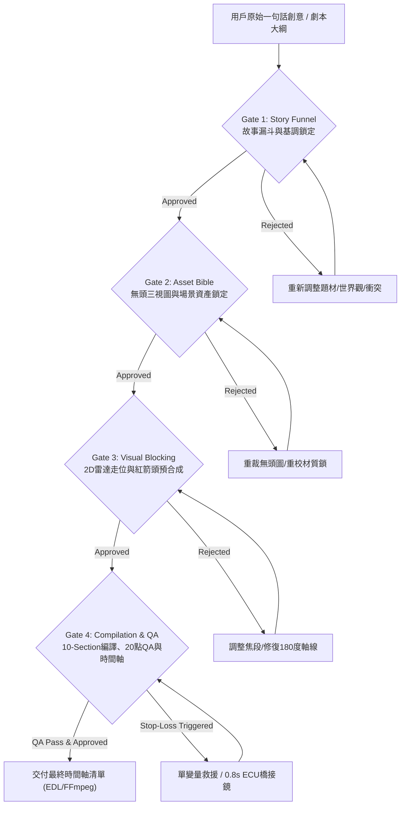

# Guided Storyboard Director（引導式分鏡導演技能）

本技能為 SSRStudio v2 系統中的 **第二層階段導演技能（Stage Director Skill / OpenMontage 相容架構）**。主要職責是引導使用者（或自主執行的 Coding Agent）嚴格遵循電影工業級生產標準，通過四大審批閘門（4 Approval Gates），完成從原始概念到高保真分鏡、決定論提示詞編譯、單變量防禦救援與最終時間軸合成的全流程。

---

## 核心設計理念與職責邊界

1. **單一真實數據源（Single Source of Truth）**：
   所有階段產出均持久化於 `projects/<project-id>/project.json`，並隨各閘門審核自動生成帶時間戳的檢查點（`checkpoints/`）。
2. **零憑空臆測（Zero Hallucination Pipeline）**：
   禁止跳過上游閘門直接生成下游提示詞。未完成角色無頭三視圖與場景鎖定（Gate 2），不得進行分鏡走位（Gate 3）；未通過 20 點 QA 審計（Gate 4），不得交付最終渲染。
3. **雙模並行相容**：
   同時支援新手「導演引導精靈（Guided Wizard）」與專業「戰術控制台（Tactical Studio）」，所有操作均對應明確的 REST API 與 SSE 即時事件。

---

## 四大審批閘門流程（The 4 Approval Gates）



---

## Gate 1: 故事漏斗提案與基調鎖定（Story Funnel Proposal）

### 1. 職責與目標
將用戶隨機、發散的原始一句話構想，收斂為具備嚴格電影工業約束的「五階段故事漏斗（5-Stage Story Funnel）」：
- **`genre_tone`**：電影類型與調性（例如：*Cinematic Neo-Noir Cyberpunk Thriller*）。
- **`world_reality`**：物理世界真實性與環境設定（例如：*Rain-slicked Tokyo mega-vault in 2089, high-contrast industrial dystopia*）。
- **`core_conflict`**：核心戲劇衝突（主體與對立力量之具體對抗）。
- **`protagonist_arc`**：主角人物弧光（從起始心理狀態到結束轉變）。
- **`visual_motif`**：視覺母題（例如：*High-contrast cyan laser beams cutting through wet concrete, reflective rain, tungsten rim*）。
- **規格約定**：預設畫面長寬比一律鎖定為 **`2.39:1` Anamorphic CinemaScope**，目標總片長預設為 30 秒（或 3–6 顆鏡頭）。

### 2. 執行操作與 REST API
調用引導精靈一鍵開案接口：
```bash
POST /api/wizard/bootstrap
Content-Type: application/json

{
  "title": "Cyber Heist",
  "idea": "一名獨臂駭客在量子金庫中避開機甲守衛的紅外線掃描，爭奪最後的解密金鑰",
  "shot_count": 3,
  "style_preset": "hell_grind_anamorphic"
}
```

### 3. Gate 1 審核驗收清單
- [ ] 題材與類型是否具備高視覺辨識度？
- [ ] 視覺母題是否包含具體的色彩溫度與材質（避免「好看的畫面」等空泛詞）？
- [ ] 長寬比是否明確標記為 `2.39:1`？
- **核准指令**：
  ```bash
  POST /api/projects/{project_id}/gates/story_funnel
  {"status": "approved", "notes": "故事漏斗結構明確，核心衝突具備電影張力，准許進入資產鎖定"}
  ```

---

## Gate 2: 角色無頭三視圖與場景資產聖經鎖定（Asset Bible Locking）

### 1. 職責與目標
防止 AI 生成影片時常見的「臉部融化」、「服裝在鏡頭切換時變形」與「場景光影錯亂」。
必須建立嚴格的具名句柄（Handle）與物理鎖定字串：
- **角色資產（`CharacterAsset`）**：
  - `handle`：唯一句柄（如 `@elena`、`@kane`）。
  - `wardrobe_lock`：布料材質、剪裁細節與磨損單調性（如 *matte black tactical raincoat with silver circuit seams, damp shoulders*）。
  - `voice_lock`：逐字語音發音錨點（如 *Measured alto voice, crisp consonant articulation, slight vocal fry*）。
  - **無頭三視圖（Headless 3-Panel Sheet）**：透過 `image_ops.create_headless_character_sheet()` 裁切去除全身圖頂部 22% 臉部區域，鎖定全身版型與比例，杜絕臉部均質化干擾。
- **場景資產（`LocationAsset`）**：
  - `handle`：唯一句柄（如 `@quantum_vault`）。
  - `lighting_lock`：主光角度與明確色溫（如 *Directional key 5600K overhead strip lights + sharp contre-jour rim*）。
  - `architecture_lock`：建築結構與地面反射（如 *Brutalist obsidian pillars and wet grated steel floor*）。
- **道具資產（`PropAsset`）**：
  - `handle`：唯一句柄（如 `@decryptor_tool`）。
  - `material_lock`：握持接觸面、金屬材質與刻痕（如 *weathered brass casing with knurled grip and glowing cyan diode*）。

### 2. 執行操作與 REST API
上傳全身圖並自動裁切無頭圖：
```bash
POST /api/assets/headless-crop
Content-Type: multipart/form-data

file=@turnaround.png
top_crop_ratio=0.22
```

### 3. Gate 2 審核驗收清單
- [ ] 所有角色均已指派唯一 `@handle` 且服裝鎖定包含具體織物與顏色？
- [ ] 角色無頭三視圖已成功剝除臉部特徵並寫入防禦詮釋資料？
- [ ] 場景光影鎖定包含具體色溫（K數）與主光方向？
- [ ] 道具材質已鎖定，無模糊通用代名詞？
- **核准指令**：
  ```bash
  POST /api/projects/{project_id}/gates/asset_bible
  {"status": "approved", "notes": "角色無頭圖與場景色溫鎖定完備，准許進入分鏡走位"}
  ```

---

## Gate 3: 多鏡頭 2D 雷達走位與紅箭頭預合成（Spatial Blocking & Pre-Comp）

### 1. 職責與目標
建立真實物理分鏡，將鏡頭與主體配置在可量化的空間座標系中，防止模型產生「空間跳躍」與「跨越 180 度軸線」的致命缺陷：
- **鏡頭階層（`ShotSpec`）**：
  - 鏡頭時長（Duration）：鎖定為 **5 秒、10 秒或 15 秒**（模型最佳穩定區間）。
  - 電影定焦鏡頭（Lens Lock）：**24mm**（極限環境透視）、**35mm**（經典敘事廣角）、**50mm**（人眼標準視角）、**85mm**（電影人像特寫）、**135mm**（壓縮戰鬥特寫）。
  - 鏡頭運動（Camera Move）：鎖定為明確物理承載（如 *Locked-off tripod*、*Slow dolly-in along floor grate*、*Smooth lateral tracking shot*）。
- **2D 空間雷達座標（`SpatialNode`）**：
  - 角色、攝影機、燈光與道具在歸一化畫布 $(x \in [0, 1], y \in [0, 1])$ 上明確標記位置與朝向角度（$0^\circ \sim 360^\circ$）。
  - 嚴格遵守 180 度攝影機軸線（Camera Axis），同場景內鏡頭視線方向嚴格一致。
- **紅箭頭物理接觸預合成圖（Red-Arrow Contact Sheet）**：
  - 涉及手部拾取或道具交握的鏡頭，調用 `image_ops.render_red_arrow_contact_sheet()` 在底圖繪製 `#FF0000` 高反差接觸箭頭與標註框，作為 First Frame 的強錨點輸入。
- **本地 Animatic 分鏡板預覽**：
  - 自動呼叫 `LocalAnimaticProvider` 產生 `1920×804` (2.39:1) 技術分鏡板，標記構圖線、視線方向向量與焦段資訊。

### 2. Gate 3 審核驗收清單
- [ ] 2D 雷達座標是否皆具備實體公尺距離換算（避免出現 `near`、`beside`、`next to` 等模糊介系詞）？
- [ ] 攝影機視角是否跨越 180 度軸線？角色左右螢幕朝向是否一致？
- [ ] 關鍵道具交互是否已有 `#FF0000` 紅箭頭接觸預合成圖？
- [ ] 本地 Animatic 技術分鏡板是否已確認構圖？
- **核准指令**：
  ```bash
  POST /api/projects/{project_id}/gates/storyboard_blocking
  {"status": "approved", "notes": "空間走位與180度軸線鎖定完備，紅箭頭預合成圖就位，准許編譯提示詞"}
  ```

---

## Gate 4: 10-Section 編譯、20 點 QA 審計、單變量救援與時間軸合成

### 1. 職責與目標
將已鎖定的故事、資產與空間走位，透過決定論編譯器編譯為 Seedance 2.5 10-Section 提示詞與 SSRStudio 15-Block 提示詞矩陣，通過 20 點工業級 QA 閘門攔截，並在失敗時依循單變量停損救援法進行修復，最後完成時間軸裝配。

### 2. 執行操作與 REST API
觸發單鏡頭提示詞編譯與 20 點 QA 審計：
```bash
POST /api/projects/{project_id}/shots/{shot_id}/compile
```
回應範例：
```json
{
  "shot_id": "shot-01",
  "compiled": {
    "section_10_text": "GLOBAL STYLE: ...\nSCENE: ...\nFIRST FRAME AND SPATIAL BLOCKING: ...",
    "block_15_text": "[01/15] GLOBAL_STYLE_PREFIX: ...\n[02/15] POSITIVE_CONSTRAINTS: ..."
  },
  "qa": {
    "passed": true,
    "score": 20,
    "checks": [...]
  }
}
```

### 3. 20 點 QA 審計標準（QA Audit Protocol）
必須全數 20 點通過（Score = 20/20）：
1. **qa-01 Zero mm/ISO lens tags**：禁止動作描寫中外洩 ISO、f-stop、曝光時間等原始參數。
2. **qa-02 Zero emotion adjectives**：禁止 `sad`、`angry`、`scared` 等抽象情感詞，一律轉譯為梅斯納生理肌肉動作。
3. **qa-03 Headless sheet law locked**：角色服裝材質鎖定，並聲明由無頭圖與 3/4 特寫圖約束。
4. **qa-04 Pupil catch-lights enabled**：角膜反射點與微眼動指令啟用。
5. **qa-05 FOV optical stack >= 4**：具備至少 4 項光學屬性（變形寬銀幕、焦段、景深壓縮、散景）。
6. **qa-06 Single light source logic**：主光源方位與明確色溫（K數）鎖定。
7. **qa-07 Contre-jour shadow side**：具備逆光輪廓光（Rim Light）與暗部反差分離。
8. **qa-08 180° camera axis respected**：180 度軸線與螢幕方向嚴格約束。
9. **qa-09 Measurable meter distances**：空間描述包含可度量公尺數據與螢幕象限。
10. **qa-10 Red-arrow prop locked**：英雄道具材質鎖定並具備紅箭頭接觸錨點。
11. **qa-11 Meisner action verb obj**：具備外部物理刺激與即時生理微動作反應。
12. **qa-12 Hand business stop cue set**：手部動作於台詞宣讀瞬間具備明確凝結停頓指令（Stop cue）。
13. **qa-13 Phased micro-blinking on**：包含分階段眨眼節奏（如 1.2s 慢眨、4.5s 雙眨）。
14. **qa-14 Audio strictly isolated**：語音音色特徵鎖定且台詞嚴格孤立。
15. **qa-15 Filler-Babble fix applied**：嚴格應用廢話抑制語句（非說話角色閉嘴凝聽，無多餘附和）。
16. **qa-16 First-second wide holding**：第 0–1 秒維持初始幀鎖定，杜絕瞬時位移畸變。
17. **qa-17 3-sentence cap respected**：單顆鏡頭動作描寫不超過 3 個精確短句。
18. **qa-18 States not transitions**：物理狀態（汗、血、污漬、雨水）單調累加而不消失。
19. **qa-19 No stale scene @tags**：提示詞內所有 `@handle` 均有已註冊資產對應。
20. **qa-20 Anti-drift negative sealed**：封裝防肢體畸變與畫面飄移之標準負向提示詞。

### 4. 單變量停損救援流程（Stop-Loss Rescue Protocol）
若生成結果不理想，必須依循嚴格的單變量迭代紀律：
- **Diff 紀律**：調用 `analyze_single_variable_diff(prev, curr)`，嚴禁同時修改超過 1 個區塊或參數。
- **迭代 1–9 次**：微調單一字詞（如加強紅箭頭坐標或降低運動幅度）。
- **迭代 10–14 次**：觸發警告 `SIMPLIFY_BLOCKING_OR_REANCHOR`，強制將鏡頭縮短為 5 秒，簡化走位並重新錨定首幀。
- **迭代 15+ 次**：強制停損 `INSERT_REACTION_BRIDGE_SHOT`，插入 0.8 秒（20 幀 @ 24fps）極限特寫（ECU）或反應切鏡，斬斷模型物理動力學崩潰鏈路。

### 5. 時間軸合成清單（Timeline Manifest Assembly）
通過審批後，系統自動生成時間軸合成清單：
- 支援 J-Cut / L-Cut 音訊交疊配置。
- 輸出標準 FFmpeg 串接腳本與 EDL 時間碼清單。
- **核准指令**：
  ```bash
  POST /api/projects/{project_id}/gates/final_render
  {"status": "approved", "notes": "全部分鏡通過20點QA，單變量救援記錄歸檔，准許交付最終時間軸合成"}
  ```

---

## 導演引導者自檢守則

1. **始終引導而非代勞決策**：在提出分鏡或改進建議時，明確向用戶解釋選擇該焦段與走位的電影語法依據（例如：「此處選用 85mm 淺景深人像鏡，是為了在核心衝突爆發前孤立主角的心理狀態」）。
2. **守護閘門完整性**：若發現用戶試圖跳過 Gate 2 直接進行走位，應主動提示並阻止：「檢測到尚未完成角色無頭圖裁切，強行進入走位將導致視訊模型臉部與服裝產生漂移，請先確認角色資產」。
3. **保持冷靜的工程紀律**：當面臨生成失敗時，絕不隨機重寫大量提示詞，而是透過 Diff 救援日誌精確鎖定單一變量。
