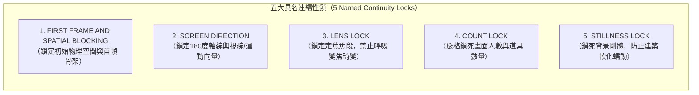

# Seedance Prompt Compiler（Seedance 2.0 / 2.5 模型提示詞編譯規範）

本技能為 SSRStudio v2 系統中的 **第三層模型適配技能（Model Provider Skill / OpenMontage 相容架構）**。本技能專注於將電影導演分鏡語法精確轉譯為位元組跳動（ByteDance）旗下 **Seedance 2.0 與 2.5** 視訊擴散架構（Video Diffusion Transformer）能夠無歧義執行的標準提示詞契約。

---

## 一、Seedance 提示詞工程底層原理

### 1. 為什麼自然語言敘述會導致視訊模型幻覺？
傳統一段式的長篇大論自然語言（Unstructured Paragraph）在經過 Transformer 的文字編碼器（如 T5 或 CLIP）處理時，後方句子的自注意力權重會隨上下文長度增加而發生衰減（Attention Dilution）。模型常常遺忘攝影機焦段、讓多餘的角色憑空出現、或在第 3 秒突兀改變打光方向。

### 2. 結構化分段標籤作為注意力條件約束器（Section Headers as Attention Conditioners）
Seedance 2.0 / 2.5 經過大量影視結構化資料對齊。使用明確的大寫分段標頭（如 `GLOBAL STYLE:`、`OPTICS / CAMERA:`、`PHYSICS:`）能夠在潛空間的交叉注意力層（Cross-Attention Layers）建立清晰的特徵隔離槽位（Feature Slots），保證：
- 光學參數嚴格約束攝影機投影矩陣；
- 物理標籤嚴格約束剛體運動與碰撞；
- 空間標籤強制鎖定第一幀坐標。

---

## 二、Seedance 10-Section 標準結構契約（Verbatim 10-Section Contract）

所有交付予 Seedance 視訊模型的提示詞，必須完全符合以下 10 個核心段落格式：

```text
GLOBAL STYLE: Feature film cinematic capture, 2.39:1 CinemaScope, anamorphic optical texture with subtle horizontal breathing, low-key directional lighting, tactile atmospheric grain. Cinematic Neo-Noir Cyberpunk Thriller. High-contrast cyan laser beams cutting through wet concrete.

SCENE: Scene sc-01 - Shot 1: Vault Entry (10s). Core narrative tension: Elena must bypass the laser grid before the patrol warden arrives.

CHARACTERS: @elena (Elena Vance) in matte black tactical raincoat with silver circuit seams. Headless sheet consistency verified: facial features sampled strictly from 3/4 close-up sheet. Zero face-averaging artifacts.

LOCATION: @quantum_vault (Sub-level 9 Quantum Vault). Brutalist obsidian pillars and wet grated steel floor.

FIRST FRAME AND SPATIAL BLOCKING:
First frame locked with Elena crouched behind the obsidian pillar at screen-left.
SPATIAL BLOCKING & RADAR GEOMETRY (Lens: 35mm, Camera Move: Slow dolly-in along floor grate):
- Camera placement: at 0.50x, 0.90y [screen-center, foreground], 180° camera axis strictly respected.
- @elena position: screen-left in the foreground (approx. 1.8m from lens), torso and eyeline oriented at 45° (camera-forward / downstage (90°)).

SHOT SPECIFICATION: Shot 1 (Duration: 10s, Hard cut). Action beat: Red laser beam slices 2cm past her left cheek -> Pupils dilate, jaw clenches, right thumb clicks the brass decryptor switch twice.

OPTICS / CAMERA:
LENS LOCK: 35mm anamorphic prime, zero focal length shift.
SCREEN DIRECTION: @elena faces screen-right throughout, strictly maintaining 180-degree axis.
Camera Move: Slow dolly-in along floor grate. 84° Classic Wide / Cuarón Intimate (35mm), actor moves through frame planes without optical cut.

PHYSICS:
COUNT LOCK: Exactly 1 human character in frame.
STILLNESS LOCK: Background architectural obsidian pillars and steel floor grates remain completely rigid.
MONOTONIC STATE: Rain droplets on raincoat collar persist monotonically without drying.
Ground-contact physics enforced: boots cast contact shadows.

LIGHTING: Overhead cold 5600K strip lights + sweeping red laser grid creating sharp 45° contre-jour rim separation and deep shadow side exposure.

AUDIO: Voice Identity: Measured alto voice, crisp consonant articulation, slight vocal fry
Line: "We have twelve seconds."
Filler-Babble Fix: Nobody else speaks; other visible characters keep lips at rest, jaw closed, strictly silent listening beat after line is spoken. No ad-libs. SFX only. No background music. No subtitles.
```

---

## 三、五大具名連續性鎖（The 5 Named Continuity Locks）

在多鏡頭生成中，五大連續性鎖是抵禦模型隨機性的防線：



### 1. `FIRST FRAME AND SPATIAL BLOCKING`（首幀與空間走位鎖）
- **定義**：在影片動作開始（第 0 秒）前，凍結主角與攝影機的幾何座標與視線方向。
- **語句標準**：
  `First frame locked with @subject crouched at [screen-left/center/right] in the [foreground/midground], torso oriented at [N] degrees.`
- **作用**：杜絕生成啟動時角色的瞬間位移與穿模。

### 2. `SCREEN DIRECTION`（螢幕方向與 180 度軸線鎖）
- **定義**：鎖定角色在畫面中運動的方向（Screen-Left to Screen-Right）以及視線朝向，同場景內鏡頭切換不得跨越 180 度中軸線。
- **語句標準**：
  `SCREEN DIRECTION: @character faces screen-right throughout; camera maintains position on the eastern hemisphere of the axis line. Zero axis flip.`

### 3. `LENS LOCK`（鏡頭光學鎖）
- **定義**：鎖定所使用的固定焦段電影定焦鏡頭（Prime Lens），禁止模型在鏡頭內部產生自動推拉變焦（Zoom）或焦段抖動。
- **語句標準**：
  `LENS LOCK: 35mm anamorphic prime, zero focal length shift, constant optical perspective.`

### 4. `COUNT LOCK`（數量鎖）
- **定義**：明確計算並鎖定畫面上出現的具體個體數量，防止擴散模型在背景或邊緣「無中生有」生成複製人、多餘的手指或憑空出現的群眾。
- **語句標準**：
  `COUNT LOCK: Exactly 1 human character (@elena) in frame; exactly 1 primary hero prop (@decryptor). No bystander clones.`

### 5. `STILLNESS LOCK`（靜止物體剛體鎖）
- **定義**：指定背景建築、固定道具、牆面與地板維持絕對剛體物理性質，防止神經網路常見的「牆壁蠕動」、「金屬軟化」與「背景液體化」。
- **語句標準**：
  `STILLNESS LOCK: Obsidian pillars, iron floor grates, and heavy steel vault doors remain completely rigid, static, and deformation-free throughout the entire shot.`

---

## 四、SSRStudio 15-Block 提示詞矩陣映射表（The 15-Block Matrix）

除了 Seedance 10-Section 格式外，SSRStudio v2 的核心編譯器亦支援完整的 15-Block 矩陣映射，供全流程精密控制：

| 區塊編號 | 區塊名稱 | 核心職責 | 對應 10-Section 來源 |
| :--- | :--- | :--- | :--- |
| **`[01/15]`** | `GLOBAL_STYLE_PREFIX` | 長寬比（2.39:1 CinemaScope）、膠卷顆粒感、核心電影基調與視覺母題。 | `GLOBAL STYLE` |
| **`[02/15]`** | `POSITIVE_CONSTRAINTS` | 正向約束：精確角色人數、道具數量、腳底與地面之物理陰影接觸。 | `PHYSICS` (Count lock) |
| **`[03/15]`** | `CAMERA_PERSPECTIVE_AND_FOV` | 視野角度與焦段特性（如 35mm 84° Cuarón Intimate），禁止 mm 外洩至動作。 | `OPTICS / CAMERA` |
| **`[04/15]`** | `CAMERA_MOTION_AND_SPEED` | 攝影機運動模式（Dolly / Pan / Track / Crane），禁止搖晃。 | `OPTICS / CAMERA` |
| **`[05/15]`** | `LIGHTING_AND_COLOR_SCIENCE` | 主光來源、色溫（5600K / 3200K）、45° 逆光輪廓光（Contre-jour）。 | `LIGHTING` |
| **`[06/15]`** | `LOCATION_ENVIRONMENT_PLATE` | 場景環境底板、建築質地、空氣中懸浮微粒與地板漫反射。 | `LOCATION` |
| **`[07/15]`** | `SPATIAL_ANCHORS_AND_GEO` | 2D 走位雷達座標轉換文本，包含公尺距離、螢幕象限與視線角度。 | `FIRST FRAME AND SPATIAL BLOCKING` |
| **`[08/15]`** | `CHARACTER_IDENTITY_AND_WARDROBE`| 角色 `@handle`、姓名、無頭三視圖一致性聲明與服裝織物細節。 | `CHARACTERS` |
| **`[09/15]`** | `HERO_PROPS_AND_INTERACTION` | 英雄道具材質、力矩、紅箭頭指引接觸點與指關節受力發白描寫。 | `CHARACTERS` / `PHYSICS` |
| **`[10/15]`** | `MEISNER_OBJECTIVE_AND_BEHAVIOR` | 外部物理刺激與梅斯納即時生理微動作反應，手部動作停頓提示。 | `SHOT SPECIFICATION` |
| **`[11/15]`** | `EYE_LIFE_AND_MICRO_EXPRESSIONS` | 微眼動（Micro-saccades）、分階段眨眼時間碼與角膜高光反射。 | `SHOT SPECIFICATION` |
| **`[12/15]`** | `ACTION_TIMING_BEATS` | 嚴格按秒劃分之動作時序（0-1s 穩定幀、1-4s 刺激、4-8s 微反應、8-10s 台詞）。 | `SHOT SPECIFICATION` |
| **`[13/15]`** | `SEAM_STITCH_AND_FIRST_SECOND_WIDE`| 第一秒穩定拍（Stabilization beat）與台詞收尾接合部。 | `FIRST FRAME AND SPATIAL BLOCKING` |
| **`[14/15]`** | `ISOLATED_AUDIO_AND_DIALOGUE` | 孤立語音音色特徵、精確台詞、廢話抑制條款（Filler-Babble Fix）。 | `AUDIO` |
| **`[15/15]`** | `NEGATIVE_AND_ANTI_DRIFT_LOCKS`| 負向反漂移鎖：禁止肢體融化、浮空靴、跨越 180 軸、無故假笑、複數太陽。 | 系統負向提示詞 |

---

## 五、逐字語音音色錨點範本（Phonetic Voice-Lock Templates）

視訊生成模型在合成音訊或嘴型對齊（Lip-Sync）時，極易產生黏連與無意義的隨機胡言亂語（Filler-Babble）。必須在提示詞中為每個角色建立具備物理聲學特徵的 `voice_lock` 錨點字串：

### 1. 聲學特徵四大維度（The 4 Acoustic Dimensions）
- **音域與共鳴腔（Vocal Register & Resonance）**：Alto / Baritone / Tenor / Chest resonance / Nasal.
- **咬字發音節奏（Articulation & Cadence）**：Crisp consonant articulation / Monotone clipped cadence / Measured gravelly pacing.
- **物理雜訊質感（Acoustic Texture）**：Slight vocal fry / Breathy / Raspy smoker rasp / Sub-bass undertone.
- **語言重音與穩定度（Accent & Pitch Stability）**：Neutral mid-Atlantic / Low-frequency vocal weight / Grounded steady pitch.

### 2. 工業級經典角色音色範本（Verbatim Templates）

#### A. 孤傲冷酷的科技潛行者（The Cynical Operative）
```text
Measured alto voice, crisp consonant articulation, slight vocal fry on phrase endings, grounded chest resonance, flat unemotional delivery without melodic inflection.
```

#### B. 歷經風霜的硬漢格鬥家 / 老兵（The Weathered Veteran）
```text
Heavy gravelly baritone, raspy smoker timbre, low-frequency sub-bass resonance, clipped rhythmic cadence with hard consonant stops, dry throat texture.
```

#### C. 機械改造宗師 / 冷血智庫（The Cybernetic Mastermind）
```text
Resonant mid-register baritone, precise surgical diction, unhurried cadence with perfectly uniform syllable duration, zero breath noise, sterile acoustic clarity.
```

#### D. 年輕恐慌但堅毅的新手（The Desperate Rookie）
```text
Tense rapid tenor, shallow breath catches between words, tight throat constriction, sharp staccato articulation with subtle pitch trembling under physical exertion.
```

### 3. 廢話抑制條款（The Filler-Babble Fix Clause）
在任何包含對白的鏡頭中，**必須逐字包含以下標準條款**：
```text
Filler-Babble Fix: Nobody else speaks; other visible characters keep lips at rest, jaw closed, strictly silent listening beat after line is spoken. No ad-libs. SFX only. No background music. No subtitles.
```
此條款能強效阻止模型讓鏡頭內的背景群眾或對戲搭檔產生不自主的碎碎唸與嘴部抽動。
